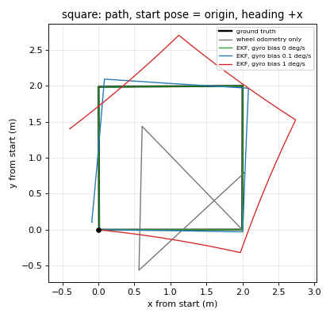
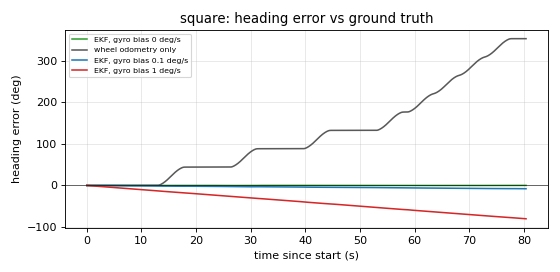
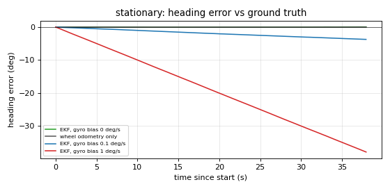

# EKF: wheel odometry + IMU

Issue: #9. The APLC fuses wheel odometry and the IMU with an extended Kalman filter
(`robot_localization` `ekf_node`) into one smooth motion estimate, published as
`/odometry/filtered` and as the `odom → base_footprint` transform.

The EKF's job is **accuracy between corrections**. It is not expected to hold heading on
its own over a multi-minute drive: any gyro bias integrates into heading drift. Long-run
drift will be bounded by visual corrections from RTAB-Map (planned), which correct the
`map → odom` transform; the EKF keeps `odom → base_footprint` smooth and accurate over the
seconds to tens of seconds between them.

- Package: `src/aplc_localization` (`config/ekf.yaml`, `launch/localization.launch.py`)
- Started by default from `ros2 launch aplc_gazebo world.launch.py` (`localization:=false`
  to skip). On its own: `ros2 launch aplc_localization localization.launch.py`.

## Frames and who publishes what

```
odom ──(EKF, 50 Hz)──► base_footprint ──(fixed)──► base_link ─┬─► imu_link
                                                              ├─► wheel links (robot_state_publisher, from /joint_states)
                                                              └─► camera frames

ground_truth_world ──► base_footprint     Gazebo truth, on /ground_truth/odom only, never on /tf
```

| Transform / topic | Publisher | Notes |
|---|---|---|
| `odom → base_footprint` | `ekf_filter_node` | The **only** publisher. `diff_drive_controller` has `enable_odom_tf: false` |
| `base_footprint → base_link` | `robot_state_publisher` | Fixed, 0.2032 m up. `base_footprint` is the URDF root, on the ground under the chassis center |
| `base_link → imu_link` | `robot_state_publisher` | Fixed, identity rotation by default, so the gyro z axis is the yaw axis |
| `/diff_drive_controller/odom` | `diff_drive_controller` | Wheel odometry, child frame `base_footprint`. EKF input |
| `/imu` | Gazebo IMU (bridged) | Simulated BNO085, 100 Hz, frame `imu_link`. EKF input |
| `/odometry/filtered` | `ekf_filter_node` | 50 Hz, frame `odom`, child `base_footprint` |
| `/ground_truth/odom` | Gazebo OdometryPublisher (bridged) | Evaluation only, see below |

Settings (`ekf.yaml`): `frequency: 50`, `two_d_mode: true` (z, roll, pitch ignored),
`publish_tf: true`, `world_frame = odom_frame = odom`, `base_link_frame = base_footprint`.
A `map` frame (global localization) comes later.

## What is fused, and why

State order: `x y z roll pitch yaw vx vy vz vroll vpitch vyaw ax ay az`.

| Source | Fused | Not fused |
|---|---|---|
| Wheel odometry `/diff_drive_controller/odom` | **vx, vy** | x, y, yaw (its own integrated pose: the filter integrates the velocities itself); **vyaw** |
| IMU `/imu` | **vyaw** (gyro z) | orientation; accelerations (ax, ay, az) |

- **vx**: forward speed from the wheels. Straight-line wheel odometry matches ground truth
  in simulation (ratio 1.000).
- **vy**: a skid steer barely moves sideways; fusing vy ≈ 0 keeps the estimate from drifting
  sideways.
- **Wheel yaw rate not fused** (deviation from the issue's starting config). On the
  four-wheel skid-steer base the wheels scrape sideways when turning, so the wheel turn rate
  reads about **1.49×** the true rate (steady in-place turn at 0.5 rad/s; whole motions
  1.40–1.56; see [wheel_encoders.md](../sensors/wheel_encoders.md)). The error is
  systematic, so no covariance can describe it; the gyro measures turn rate directly.
- **Gyro yaw rate fused**: the only turn-rate source.
- **IMU orientation not fused.** Gazebo's IMU orientation is ideal (no noise, zero
  covariance) and would hide the drift a real sensor has. In `two_d_mode` roll and pitch are
  ignored anyway (the issue suggested fusing them).
- **Accelerations off** (as the issue suggests). The simulated accelerometer carries a
  constant 80 mg bias per axis, the raw-sensor typical offset, a pessimistic case compared
  with the BNO085's calibrated output. Integrated, it would become a false velocity.
  `imu0_remove_gravitational_acceleration: true` is set for when ax is tested.
- **IMU topic is `/imu`**, not `/imu/data` as in the issue: that is what the sensor
  publishes.

## Covariances and noise

**Measurement covariances come from the messages**; `ekf.yaml` overrides none of them.

| Input | Diagonal | Source |
|---|---|---|
| Wheel odometry twist | vx 0.001, vy 0.001, z/roll/pitch 1e6, yaw rate 0.25 | `aplc_control/config/controllers.yaml` (#18) |
| Gyro (angular velocity) | 2.99e-6 (rad/s)² per axis | Gazebo: stddev² of the BMF055-based noise, 0.001728 rad/s ([imu.md](../sensors/imu.md)) |

**Process noise Q** (diagonal; how much each state may change between updates beyond the
motion model; larger follows measurements faster):

| State | Q | Why |
|---|---|---|
| x, y | 0.05 | pose follows the fused velocities (robot_localization default) |
| yaw | 0.06 | as above |
| vx | 0.05 | the robot accelerates at up to 0.5 m/s² |
| vy | 0.01 | a skid steer barely moves sideways |
| vyaw | 0.1 | turn rate changes at up to 1 rad/s²; high enough to follow the gyro through turn starts and stops |
| ax, ay | 0.01 | not measured; kept small so they don't drift |
| z, roll, pitch and their rates, az | defaults | unused in `two_d_mode` |

**Initial covariance P0**: pose 1e-9 (`odom` is defined as where the filter starts, so the
initial pose is exact); velocities and accelerations 1e-6 (the robot starts at rest, but not
zero so the first measurements still update them).

## Ground truth

Gazebo's OdometryPublisher system on the robot (`aplc_description/urdf/aplc.gazebo.xacro`)
publishes the exact pose and velocity of `base_footprint`:

- Topic `/ground_truth/odom` (`nav_msgs/msg/Odometry`), 50 Hz, 3D (z, roll, pitch kept for
  the ramp), no noise.
- Frame `ground_truth_world`, deliberately **not** `odom`. Its TF topic is not bridged, so it
  never appears on `/tf`.
- The pose is world-referenced: it starts at the spawn pose (default 5, −3, 180°).

> **Ground truth is for evaluation only. It must never be an input to the EKF or any other
> estimator.** This is noted in the xacro, `bridge.yaml` and `ekf.yaml`.

## Evaluation

Tool: `aplc_localization/scripts/ekf_eval.py` (orchestrator and analysis) and
`ekf_eval_drive.py` (test motions). From the repository root:

```bash
ros2 run aplc_localization ekf_eval run                      # whole matrix
ros2 run aplc_localization ekf_eval run --tests stationary,square
ros2 run aplc_localization ekf_eval analyze                  # re-analyze existing bags
```

Options: `--repeats N` (seeds 1..N), `--seed`, `--overwrite` (re-run cases whose bag
exists), `--door-bag PATH`, `--bags DIR`, `--results DIR`.

**Per run**: a fresh headless launch (`gui:=false camera:=false`) with the case's gyro bias,
EKF config and Gazebo seed; a rosbag of `/diff_drive_controller/odom`,
`/odometry/filtered`, `/imu`, `/ground_truth/odom` in `eval_bags/` (gitignored); the test
motion; shutdown. Each run takes about 45 s (stationary) or 85 s (square) plus launch.

**Tests** (each starts with 2 s at rest and ends with 3 s to settle):

1. **Stationary**: 30 s at rest.
2. **Square + spin**: 2 m sides at 0.3 m/s, left turns at 0.5 rad/s, then a 360° spin.
   Open loop; turn times are scaled by the measured slip (1.49) so the true turns are close
   to 90°. No ground truth is used to drive.
3. **Door-to-car**: replays a recorded teleop `cmd_vel` bag from inside the front door to
   the parked car. **Pending**, see below.

**Matrix**: each test × gyro bias 0, 0.1 and 1 °/s, accelerations off; plus door-to-car with
gyro bias 0.1 °/s and ax on (pending with the door test).

- **0 °/s**: perfect calibration.
- **0.1 °/s**: an **assumed** residual after the BNO085's onboard calibration. Replace it
  with a value measured from stationary data on the real sensor.
- **1 °/s**: the raw-sensor typical zero-rate offset (Bosch BMF055 datasheet), the worst
  case.

**Repeatability**: `gz sim --seed` makes sensor noise and the random bias signs identical
between launches (verified), so each case runs once (seed 1). Recording length varies by
1–2 s with startup timing, so the analysis cuts all runs of a test to the shortest one.

**Analysis**: t0 is the first instant all three pose sources publish (robot at rest). Ground
truth, wheel odometry and the EKF are each re-expressed relative to their own pose at t0
(position and yaw), because ground truth is world-referenced and the EKF's heading drifts
from launch. Estimates are interpolated to the ground-truth timestamps. Metrics: final, RMS
and max position error (m); final and max heading error (degrees, accumulated, not wrapped
to ±180°). Outputs in [results/](results/): `summary.md`, `*_heading_error.png`,
`*_path.png`.

## Results (stationary and square)

Simulation, seed 1. Full table: [results/summary.md](results/summary.md).

| Test | Gyro bias | Estimator | Final position error | RMS position error | Max position error | Final heading error | Max heading error |
|---|---|---|---|---|---|---|---|
| Stationary, 38 s | any | wheel only | 0.000 m | 0.000 m | 0.000 m | 0.00° | 0.00° |
| Stationary, 38 s | 0 | **EKF** | 0.000 m | 0.000 m | 0.000 m | +0.06° | 0.06° |
| Stationary, 38 s | 0.1 °/s | **EKF** | 0.000 m | 0.000 m | 0.000 m | −3.73° | 3.73° |
| Stationary, 38 s | 1 °/s | **EKF** | 0.000 m | 0.000 m | 0.000 m | −37.90° | 37.90° |
| Square + spin, 8.0 m, 80 s | any | wheel only | 2.17 m | 1.74 m | 2.63 m | +353° | 353° |
| Square + spin, 8.0 m, 80 s | 0 | **EKF** | 0.005 m | 0.017 m | 0.031 m | +0.11° | 0.23° |
| Square + spin, 8.0 m, 80 s | 0.1 °/s | **EKF** | 0.128 m | 0.104 m | 0.146 m | −7.92° | 7.92° |
| Square + spin, 8.0 m, 80 s | 1 °/s | **EKF** | 1.447 m | 1.087 m | 1.449 m | −80.26° | 80.26° |

Wheel-only odometry is the same in every bias case (it doesn't use the IMU); one row is
shown.







What this shows:

- **Wheel-only odometry fails on turns.** Each 90° turn is counted as about 134°, so after
  four turns and a full spin its heading is 353° ahead of the truth and its path is a
  triangle, ending 2.17 m from where the robot really is. Straight driving and standing
  still are exact.
- **With a calibrated gyro the EKF tracks the truth closely**: 5 mm and 0.11° after the 8 m
  square.
- **With a biased gyro the EKF's error is the bias integrated over time**: −3.7° (0.1 °/s)
  and −37.9° (1 °/s) in 38 s at rest; −7.9° and −80° over the 80 s square, which bends the
  path (0.13 m and 1.45 m final error). Nothing in this filter can remove a constant gyro
  bias (wheel yaw rate isn't fused and robot_localization has no bias state), which is why
  the onboard calibration, a startup gyro calibration and RTAB-Map corrections matter.
- Even at the 1 °/s worst case, the EKF beats wheel-only odometry on the square (1.45 m vs
  2.17 m final, 80° vs 353° heading).

### Door-to-car: pending

The issue's done-criterion (drift over the door-to-car drive) is **not yet measured**. A
teleop route was recorded (`cmd_vel` only, 149.7 s, 481 commands) to replay in every run,
but the replay does not follow the live drive:

- On the ramp the replayed heading drifted to about −100°, toward the house wall, and the
  robot's side touched the wall (0.000 m clearance).
- At the ramp foot it was pinned against the wall (centre 0.27 m from it, half-width
  0.268 m), so the recorded left turn could not rotate it; it drove on past the driveway
  and never reached the car.
- Two replays agree within 3 cm, so the replay itself is repeatable; the problem is that an
  open-loop replay can't repeat the corrections the driver made by eye. Small differences in
  when commands reach the 50 Hz controller change each turn slightly, and wall contact on
  the narrow ramp amplifies them.

Next step: re-record with margin (stay in the middle of the ramp, drive past the ramp foot
to the middle of the driveway before turning, stop between turning and driving), check the
replay's clearance and end pose, then run the door cases including ax on vs off.

## Sim-to-real notes

- **Gyro bias dominates heading drift.** Measure the real BNO085's residual bias from
  stationary data and replace the assumed 0.1 °/s. Add a startup gyro calibration (see open
  items).
- **IMU orientation is not fused.** In simulation it is ideal; on hardware the BNO085's
  fused orientation has a few degrees of error (datasheet: 1.5–2.5° non-heading error for
  the game rotation vector). Revisit when a 3D estimate is needed.
- **Slip depends on the surface.** The 1.49 turn ratio is for the simulated driveway; carpet,
  tile and wood will differ, and turning while driving forward differs from turning in
  place. This doesn't change the EKF (wheel yaw rate isn't fused) but does change wheel-only
  odometry and the vx/vy covariances' validity.
- **The ramp is hard for open-loop motion.** The failed door-to-car replay drifted toward
  the wall on the ramp; expect the real robot's heading on slopes and near walls to need
  closed-loop control.
- **The planned tracked base slips more when turning** than four wheels; re-measure slip and
  re-tune when it is modelled.
- **Retune covariances on hardware**: the wheel twist covariances, the IMU noise (measure
  it stationary) and Q all come from simulation and datasheets.
- **Accelerometer bias**: the simulated 80 mg is the raw-sensor typical offset, a
  pessimistic case compared with the BNO085's calibrated output.
- **`two_d_mode`** ignores the ramp's tilt; position on the ramp is measured along the
  ground plane (the 4.76° slope shortens horizontal distance by 0.3 %).

## Open items

| Priority | Item |
|---|---|
| **High (hardware)** | Startup gyro calibration node: average the gyro while the robot is stationary at startup and subtract it from `/imu` before the EKF |
| High | Door-to-car evaluation (issue #9 done-criterion): re-record the route with margin, then run the door cases, including ax on vs off |
| Medium | Measure the BNO085's residual gyro bias after onboard calibration; replace the assumed 0.1 °/s |
| Medium | Move EKF, Nav2 and RTAB-Map launching into an `aplc_bringup` package |
| Low | 2D vs 3D mode comparison on the ramp (issue #9 optional) |
| Low | `wheel_separation_multiplier`: the #18 measurement suggests about 1.49 for in-place turns. It would improve wheel-only heading but not the EKF (which doesn't fuse wheel yaw rate); kept at 1.0 because slip varies with turn rate, arcs and surface |
